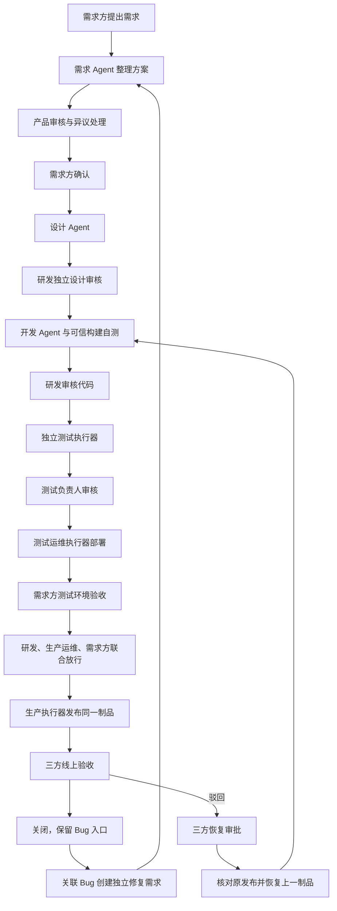

# ForgeX 2.0 P0 接入与验收

## 已实现的交付链路

2.0 的主入口为 `/delivery`。需求方看到自己的需求方案、业务测试报告、验收环境和关联 Bug；产品、研发、测试及运维按岗位处理本轮任务。所有审核都需要意见，异议未处理时不能通过。



三方审核检查不同 `actorKey`，账号发放必须确保各岗位由不同人员持有。平台管理员不能用管理员权限替代岗位审核。需求、设计和实现返工会清除下游当前结果与批准，但历史证据保留。

## 隔离样板：无需模型凭据

先执行 `npm ci`，然后在仓库根目录运行：

```bash
npm run p0:sample
```

该命令构建代码并执行所有生命周期测试。样板建立临时 Git 仓库，实际提交预约服务、运行 HTTP 自测与独立业务测试，启动隔离的测试和生产进程、验证制品健康状态，演练联合验收、Bug 修复和回滚，最后清理进程和临时数据。需求、设计和开发采用受限的固定样板，仅支持标题含“预约”的业务；它不证明真实模型已能自主交付任意项目。

数据库测试需要显式设置 `FORGEX_TEST_DATABASE_URL`，数据库名称必须以 `_test` 结尾。测试使用随机 schema 并清理，不会使用生产库。未设置时该项明确跳过：

```bash
npm run build
npm run test:p0
```

如需手动体验，在两个终端分别运行以下命令。本次开发未保留这些服务运行：

```bash
npm run p0:console
```

```bash
npm run preview --workspace @forgex/web-console -- --host 127.0.0.1
```

访问 `http://127.0.0.1:4173/delivery`。下面六个账号的样板密码均为 `P0-Sample-2026!`：

| 身份       | 账号                | 处理关卡                                            |
| ---------- | ------------------- | --------------------------------------------------- |
| 需求方     | `p0.requester`      | 提需求、确认方案、测试验收、联合审批及线上验收、Bug |
| 产品负责人 | `p0.product_owner`  | 需求方案审核                                        |
| 研发负责人 | `p0.developer`      | 设计审核、代码审核、联合审批、安排 Bug 修复         |
| 测试负责人 | `p0.tester`         | 独立测试报告审核、确认 Bug 修复                     |
| 测试运维   | `p0.test_ops`       | 核对测试部署故障并恢复执行                          |
| 生产运维   | `p0.production_ops` | 联合审批、线上验收、恢复审批与故障处置              |

浏览器样板使用内存控制面、临时数据和仅回环监听。退出控制面后样板数据清理。生产装配使用 PostgreSQL，不应使用此演示入口和公开样板密码。兼容旧浏览器验收的 `e2e.admin` 仅供旧版测试，不参与联合审批。

## 持久化控制面

生产装配在 `apps/control-plane-api/src/production.ts` 使用 `PostgresLifecycleRepository`。迁移 `0026_lifecycle_v2.sql` 增加生命周期表并扩展账号角色。沿用现有统一迁移命令：

```bash
npm run db:migrate
```

业务快照、任务、批准、幂等请求、Bug、通知已读状态及生产环境占用在同一租户事务中保存。PostgreSQL advisory transaction lock 保护多服务并发。站内通知来自持久化事件，页面轮询进度；P0 尚未接入飞书、邮件或外部消息推送。

P0 按租户存储一份版本化快照，适合验证闭环。任务最多 250 次、事件最多 2,000 条；长期使用需拆分事件和任务表、增加归档及分页，并测量实际负载。不要把样板验证推导为规模化容量保证。

## 真实执行器接入

控制面配置可新增 `lifecycleExecutors`。每项包含 `tokenSha256` 和 `executor`；后者包含 `executorKey`、`tenantKey`、`projectKey`、`repositoryKey`、`capabilities`、`publicKeyBase64`。公钥是 Ed25519 SPKI DER 的 Base64；控制面不持有私钥。令牌和人员、旧版 Worker、Runner 令牌不能复用。配置修改后按原部署说明重新计算授权配置 SHA-256。

| 执行器           | 最小能力                                      |
| ---------------- | --------------------------------------------- |
| 需求／设计／开发 | `requirements_ai`、`design_ai`、`development` |
| 独立测试         | `testing`，必须使用不同于开发的执行器身份     |
| 测试运维         | `staging_deploy`                              |
| 生产运维         | `production_deploy`、`production_rollback`    |

启动命令为：

```bash
npm run start:lifecycle --workspace @forgex/device-worker -- /absolute/path/to/private-config.json
```

执行器私有配置字段：

| 字段                 | 内容                                             |
| -------------------- | ------------------------------------------------ |
| `schemaVersion`      | `2`                                              |
| `controlPlaneOrigin` | 现有控制面 HTTPS 地址或本机回环地址              |
| `token`              | 对应控制面摘要的原始随机令牌，仅留在本地         |
| `privateKeyPath`     | 本地 Ed25519 PEM 私钥绝对路径                    |
| `journalRoot`        | 本执行器专用日志目录绝对路径                     |
| `pollIntervalMs`     | 1,000–60,000，默认 3,000                         |
| `adapter.endpoint`   | 固定受控流水线网关 HTTPS 地址或本机回环地址      |
| `adapter.token`      | 网关专用令牌，仅留在本地                         |
| `codex`（可选）      | 沿用已验证的项目、Codex 登录与隔离 launcher 配置 |

`codex` 包含 `project`、`codexHomePath`、`authentication`、`protectedPaths`、`launcherPath`、`launcherSha256`、`isolationKind` 和可选 `launcherArguments`。复用已有客户设备隔离能力；缺少它时所有自动阶段交给网关。需求和设计阶段必须保持工作树无改动；开发阶段由可信设备生成 Git 提交，网关返回的构建自测结果必须绑定该提交。

配置、私钥和日志在 POSIX 上必须仅本执行身份可读写，不能经过符号链接；Windows 验证私有 ACL。每个执行器使用独立私钥、日志和岗位能力。生产凭据保留在组织运维系统内，模型不获得生产密码、通用 Shell 或直接发布权限。

## 受控流水线网关协议

`HttpLifecycleAdapter` 向固定入口提交 `POST`，禁止重定向，认证为 `Bearer <本地网关令牌>`，`Idempotency-Key` 为任务 `jobKey`。请求是 `{ schemaVersion: 2, job, recoverOnly, candidate? }`。`candidate` 只用于设备已提交的开发结果，包含可信工作树绝对路径和 `commitSha`。

响应必须严格匹配 `LifecycleTaskResultSchema`：成功包含对应阶段的 `output`；失败／阻塞包含明确 `reason`。网关必须独立核对项目、仓库、阶段、输入摘要、任务令牌和生产三方批准，固定允许的构建与发布动作。它必须针对环境串行执行并以任务标识持久化外部副作用；`recoverOnly: true` 只能查询和核对已有结果，禁止再次构建或发布。恢复成功前重新检查当前环境、制品及原发布。

开发结果需要自测，独立测试需要覆盖所有验收条件；测试、测试部署和生产部署必须绑定同一 `commitSha`、`artifactDigest`。回滚必须核对 `productionJobKey`，并实际恢复上一已知制品。网关应将新建资源、版本与健康检查证据保存在自己的运维台账中；客户端与控制面之间的签名不是外部环境执行的替代证明。

本次已实现通用网关客户端和 Codex 适配入口，并验证隔离样板执行器。真实 CI/CD 网关、真实模型响应、组织身份源以及客户测试／生产环境需要另行接入并现场验收。

## 故障处置

任务租约 5 分钟，执行器每 30 秒续约。结果签名覆盖任务、输入摘要、隔离令牌与实际输出；过期回调拒绝。收到任务后先写本地日志，完成后先写已签名结果再回调；响应丢失时只补发同一结果。

执行中进程退出时只查询外部已有副作用，无法确认则阻塞。租约过期、被拒绝回调或损坏配置需要负责人核对日志和外部环境；不能自动清空日志重新发布。处理步骤：确认旧进程已退出，备份日志，核对网关台账；对已失效任务归档 `pending.json`，仅在旧执行器已退出后移除残留 `executor.lock`，再通过页面记录原因并恢复。本地已完成回调仍有效时应优先补发，无需清除。

生产失败重试先重新取得三方放行；恢复失败重试先重新取得三方恢复批准。发布执行中不能并行申请恢复。当前需求完成线上验收或恢复成功前，其他需求不能占用同一生产环境。首次上线没有上一制品时不会伪造回滚成功，需要生产运维核对外部环境并补充真实恢复能力。

迁移扩展了数据库角色，不能直接启动未识别新角色的旧版二进制。回退到 1.x 前必须先停用生命周期执行器、处置未完成发布、备份数据库，并清理或迁移新角色账号；勿直接删除生命周期证据。
